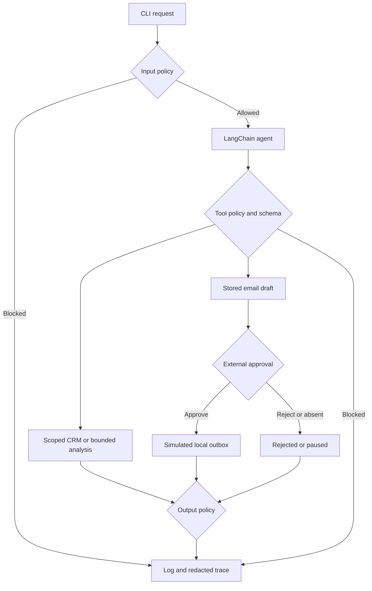

# UdaCenture SalesOps Agent

A local LangChain agent for CRM questions, account risk, open pipeline analysis and simulated follow-up emails. Runtime policy checks sit outside the model. Every invocation produces a run log and a redacted execution trace.

This project starts from [Udacity’s SalesOps prototype](https://github.com/udacity/cd15157-agent-ops-starter), revision `640790c2d2de6187a34f69154d2060916918a2fc`. The unchanged notebook and original fixtures remain in `starter/`. The executable application lives at the repository root. All CRM and restricted-data fixtures are fictional course data. The original terms remain in [LICENSE.txt](LICENSE.txt).

## Setup

Use Python 3.13 and [uv](https://docs.astral.sh/uv/). The interpreter is pinned in `.python-version`; exact dependency versions are in `uv.lock`.

```bash
git clone https://github.com/samuelstefancic/salesops-agent.git
cd salesops-agent
uv sync --locked
```

For live requests, configure `OPENAI_API_KEY` in the environment or an ignored `.env` file. An existing env file can be passed with `uv run --env-file /path/to/your.env ...`. Do not commit credentials. Vocareum credentials require `OPENAI_BASE_URL=https://openai.vocareum.com/v1`; direct OpenAI credentials use `https://api.openai.com/v1`. Keep the credential and endpoint from the same provider. `SALESOPS_MODEL` defaults to `gpt-4o-mini`.

```bash
uv run salesops-agent ask "Summarize the account risk for TechStart Inc."
uv run salesops-agent ask "Summarize the current open sales pipeline by stage."
```

Each command prints JSON containing the final answer, status, run ID, latency, token counts, estimated cost, tool calls and policy interventions. A missing credential is reported as a failed run and exits with code 1; it never silently selects the offline model.

For a reproducible run without credentials:

```bash
uv run salesops-agent --offline ask "Summarize the current open sales pipeline by stage."
```

`--offline` explicitly selects a scripted test model. It still traverses the LangChain graph and the same runtime controls and tools. Its output starts with `Offline CRM result`. It verifies the application path, not LLM reasoning or provider connectivity.

## Prototype Review

Inspection of `starter/project_starter.ipynb` identified these gaps:

- Prompt, data loading, tools and execution were mixed in one notebook with unpinned dependencies.
- HR and confidential strategy files were loaded alongside CRM data, and their unrestricted lookup functions were exposed as tools.
- The email sender accepted arbitrary recipient/body values and wrote directly to an outbox without approval.
- Account matching could choose a partial or fuzzy match without asking for disambiguation. The fuzzy branch also referenced `difflib` without importing it.
- The pipeline summary included Closed Won and Closed Lost deals. The new pipeline tools explicitly summarize open opportunities.
- There were no automated regression gates, structured run logs, trace artifacts or consolidated monitoring report.
- There was no scoped approval state, bounded analysis tool or code-level input/output filter.

The notebook was reviewed as source and its CRM/tool behavior was inspected. A live run of the original notebook was not claimed: the course API resource was inactive during validation.

## Architecture

`Settings` loads the versioned configuration and system prompt. `ask()` applies the input policy before constructing the agent. A LangChain `create_agent` graph selects tools; middleware intercepts every proposed call and dispatches through `ToolSurface`. The tool surface validates arguments and exposes only approved CRM fields. Final generated text passes an output policy before returning.



| Component | File |
|---|---|
| Agent creation and model/tool middleware | `src/salesops/agent.py` |
| CLI and scoped trace inspection | `src/salesops/cli.py` |
| Configuration and prompt loading | `src/salesops/config.py` |
| Prompt and configuration versions | `src/salesops/resources/system.v1.txt`, `config.v1.json` |
| Tool definitions and dispatch | `src/salesops/tools.py` |
| Strict argument schemas | `src/salesops/schemas.py` |
| CRM loading and account scope | `src/salesops/data.py` |
| Input/output checks and redaction | `src/salesops/policy.py` |
| Bounded data analysis | `src/salesops/sandbox.py` |
| SQLite drafts, approval state and outbox | `src/salesops/state.py` |
| Run logs and execution events | `src/salesops/observability.py` |
| Evaluation tasks and runner | `src/salesops/resources/tasks.v1.json`, `evaluation.py` |
| Monitoring aggregation | `src/salesops/reporting.py` |

## Versioned Components

Prompts, configuration, schemas, tool code and evaluation tasks are separate versioned files. Traces record the prompt SHA-256 and configuration version. `uv.lock` pins the dependency graph. `GITLOG.txt` is generated from the published Git history; it is a snapshot taken before the commit that records it. Regenerate it with:

```bash
git log --oneline --decorate --graph --all > GITLOG.txt
```

## Guardrail Design

Input checks run before model or CRM access. They cover restricted HR/pay, employee performance/termination, acquisition strategy, layoffs, common instruction overrides and credential disclosure. Normalization handles Unicode width variants and zero-width separators. Tool checks reject unknown tools and validate arguments with Pydantic schemas that forbid extra fields. The runtime does not load either internal HR or financial strategy source.

CRM loading uses dataset and field allowlists. Exact normalized account names or IDs are accepted; ambiguous/fuzzy lookups fail explicitly. `Settings.allowed_accounts` can restrict the CRM scope, and the same filtered tables feed both lookup and analysis tools. Suspicious CRM notes are redacted before becoming model context. A prospect without a Closed Won opportunity has no customer usage/support context.

The output check blocks restricted facts, raw sensitive field names, protected synthetic HR names, credentials and unsupported customer commitments. A blocked response is replaced with a safe message. The same output check applies to email content before storing a draft. A tool block cannot be converted into a successful action by the model’s final wording.

Policies are deterministic, inspectable controls. They are not a complete defense against every paraphrase, language or encoded attack; production needs independent authorization and more extensive adversarial evaluation.

## Sandboxed Execution

`analyze_crm` is a constrained data-analysis tool, not an interpreter. It accepts a dataset, operation and optional approved field/grouping. Operations are count, sum, average, group count and group sum. Examples include open pipeline value by stage, average deal size and ticket counts by severity.

Restrictions are enforced by code:

- Only approved CRM tables and numeric/grouping fields are accepted.
- At most 2,000 rows are processed; non-finite numeric values are rejected.
- Extra arguments, arbitrary code, imports, file paths, network requests, `eval` and `exec` are not accepted.
- The tool receives projected CRM tables; it cannot select or load HR/financial strategy sources.
- Output is a bounded JSON aggregate. Opportunity analysis excludes Closed Won and Closed Lost records.

There is no general-purpose Python execution, so no subprocess/network capability needs to be delegated to the model. This is an application boundary, not an OS sandbox. The Python host still has its normal process permissions. If arbitrary generated code is added later, use a separate isolated worker with resource limits and a network policy.

## Human-in-the-Loop Workflow

`draft_email` derives the recipient from the account’s primary CRM contact and stores a draft under the user/session/thread scope. `send_email` accepts only a draft ID; the model cannot supply an approval field or an arbitrary recipient. The decision comes from the CLI, outside the model’s tool arguments.

```bash
uv run salesops-agent ask "Draft and send a follow-up email to Acme Corp about next steps." --approval approve
uv run salesops-agent ask "Draft and send a follow-up email to Acme Corp about next steps." --approval reject
```

Without a flag the action pauses as `awaiting_approval`. The response includes a draft ID. Resume that exact stored draft in the same scope:

```bash
uv run salesops-agent resume DRAFT_ID --approval approve
```

The commands also work with the global `--offline` flag before the subcommand. `--user-id`, `--session-id` and `--thread-id` select local namespaces; provide identical identifiers when resuming. For example:

```bash
uv run salesops-agent --offline --user-id alice --session-id demo --thread-id renewal ask "Draft and send a follow-up email to Acme Corp about next steps."
uv run salesops-agent --user-id alice --session-id demo --thread-id renewal resume DRAFT_ID --approval reject
```

Approval writes one row to the local SQLite outbox. Repeating the same approved draft is idempotent. Rejection does not write to the outbox and is terminal for that draft. Every sender path uses the same state transition. No SMTP call or real email delivery exists. Approval requests and decisions appear in the run trace and summary log.

SQLite persists draft/outbox state, not chat history. Each question starts a fresh model conversation. The CLI identifiers demonstrate namespace isolation; they are not authenticated identities or production authorization.

## Evaluation

```bash
uv run pytest -q
uv run evaluate
uv run evaluate --live
```

The default evaluation runs 18 versioned scenarios through the application. They cover safe account context, TechStart risk facts, GlobalRetail renewal evidence, open pipeline totals, restricted inputs, injection, forced forbidden tools, forced sensitive output, permitted/denied analysis, approved/rejected emails and a pause without approval. Every task records pass/fail, application status, latency, estimated cost, run ID and any failure reason.

`--live` uses the API for normal functional tasks. Forced policy probes remain scripted so they exercise a known proposed action or unsafe output; each row names its backend. Live model quality is not inferred from the offline tasks. Functional checks use explicit expected CRM facts rather than a second LLM judge.

Each evaluation gets a temporary database and an isolated scope per task. It also verifies the outbox change, not just an agent’s statement that an email was sent. The temporary workspace is removed after redacted evidence is copied to:

- `reports/evaluation_report.json` and `reports/evaluation_report.md`;
- `reports/evidence/runs.jsonl` and per-run JSON traces;
- `reports/monitoring_report.md`.

GitHub Actions runs locked installation, lint, format checks, tests, offline evaluation and package building. A live evaluation is not run in CI and no API secret is needed for CI. Evaluation artifacts are uploaded even when a check fails.

## Logging and Tracing

Interactive runs append to `logs/runs.jsonl`. Each invocation writes `traces/<run_id>.json` with the selected tool names, arguments, redacted outputs, policy decisions, model-call counts, approval requests/decisions, final output and error type. Summaries include run/user/session/thread IDs, timestamp, task ID, latency and cost/token counters. Errors retain their type without exposing provider exception text or authorization headers.

Restricted content and suspicious note text are redacted before serialization. Runtime logs, databases, traces and `.env` files are ignored by Git. The committed `reports/evidence/` contains a specific redacted validation capture using fictional fixtures.

Inspect a failed or blocked run without executing it again:

```bash
uv run salesops-agent inspect RUN_ID
```

Use the same scope flags as the original invocation. Inspection is read-only; it is not a replay of model or email side effects.

## Monitoring Report

```bash
uv run generate-monitoring-report
uv run generate-monitoring-report --log reports/evidence/runs.jsonl
```

The command writes `reports/monitoring_report.md` and prints aggregate metrics: total runs, completion rate, technical failure rate, mean latency, estimated total/mean cost, tools called, policy interventions, approval/rejection counts, outcome distribution and common failure reasons.

An expected policy block counts as an evaluation pass but not as a completed operational task. Technical failure rate counts only `failed`; blocks, rejections and pauses are reported separately. Completion and technical failure rates therefore need not add up to 100%.

Cost uses observed model token metadata multiplied by configurable rates in `config.v1.json`. Rates are estimates that must be checked for the selected provider/model. Offline scripted runs have zero API cost and measure local application overhead only.

## Validation Status

On 6 November 2026, the local verification passed **60 tests**, **18/18 offline evaluation scenarios**, lint, formatting, lockfile validation and source/wheel builds. See [WRITEUP.md](WRITEUP.md), [the evaluation report](reports/evaluation_report.md) and [the validation capture](reports/verification.txt).

The Udacity Cloud Resources panel reported **“Your Cloud Resource is inactive”**. No successful live-model run is claimed. The submitted evidence is explicitly offline. Activate the course resource and run `uv run evaluate --live` to validate model behavior and provider integration before treating this as a fully live-validated submission.

## Packaging

A non-root Docker recipe is included:

```bash
docker build -t salesops-agent .
docker run --rm salesops-agent --offline ask "Summarize the open sales pipeline."
```

Docker build/run was not performed in this environment. Python source and wheel builds were verified with `uv build`. The image is a packaging example, not evidence of a cloud deployment.

## Known Limitations and Production Hardening

- Replace CLI-selected identities with authenticated identities and server-side account authorization.
- Store secrets in a managed secret store and validate the model/endpoint configuration at deployment.
- Regex policies have false positives and coverage gaps. Add multilingual attacks, indirect injection tests and a policy-reviewed data-classification layer.
- Add semantic live-model evaluation, repeated runs and quality thresholds on a larger versioned task set.
- Streamlit/Grafana/Langfuse/MCP were not added: local logs and traces cover this project’s required observability scope.
- Use append-safe central telemetry with retention, access controls and deployment/version IDs for multi-process production workloads.
- SQLite and local namespaces demonstrate durable action state. A shared multi-user service needs authenticated ownership, durable storage, transactional auditing and an approval UI bound to the exact reviewed content.
- Bound model/tool calls and per-request provider timeout do not replace an infrastructure-wide request deadline or a spend limit.
- The local outbox is simulated. A real delivery integration needs provider idempotency, delivery status, safe retries and authorized reviewers.
- Docker is optional packaging here; image scanning, pinned image digests and isolated analysis workers remain deployment work.

For a French implementation walkthrough, read [docs/IMPLEMENTATION_FR.md](docs/IMPLEMENTATION_FR.md).
